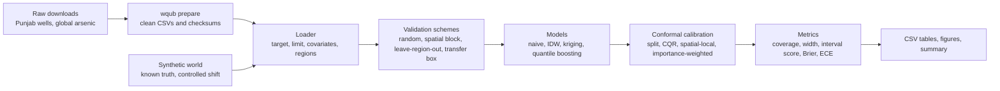
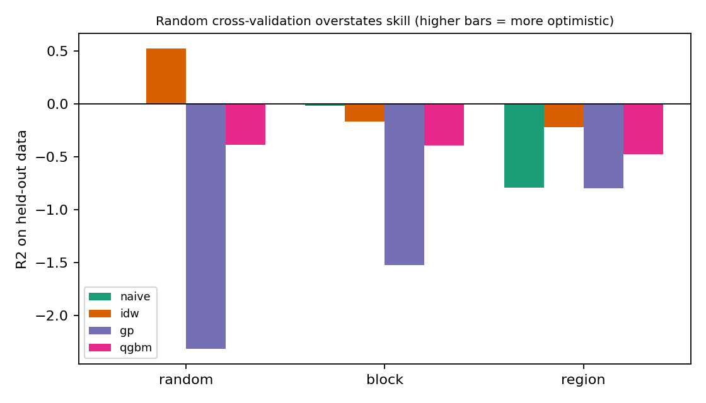
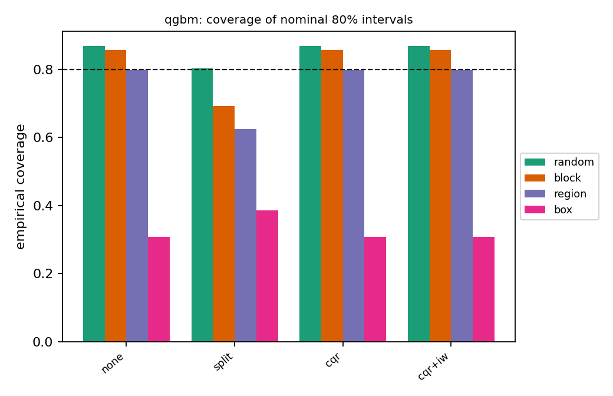
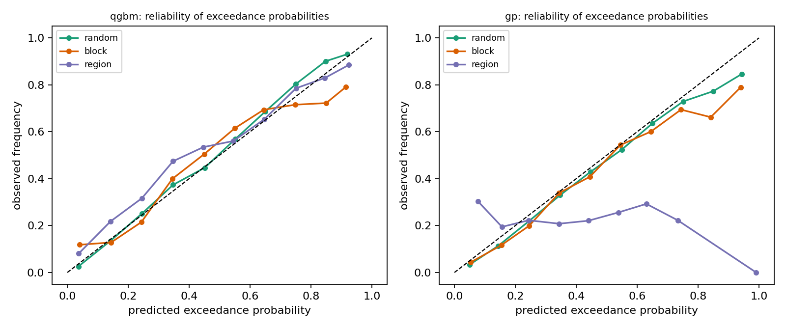
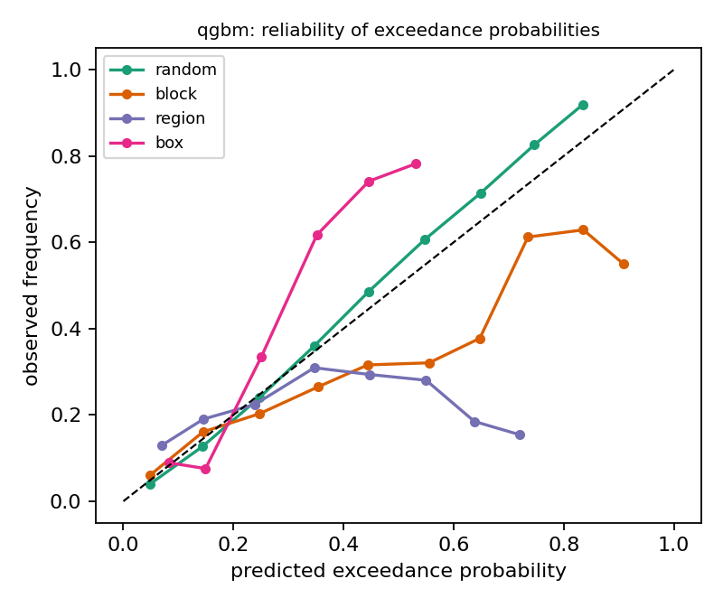
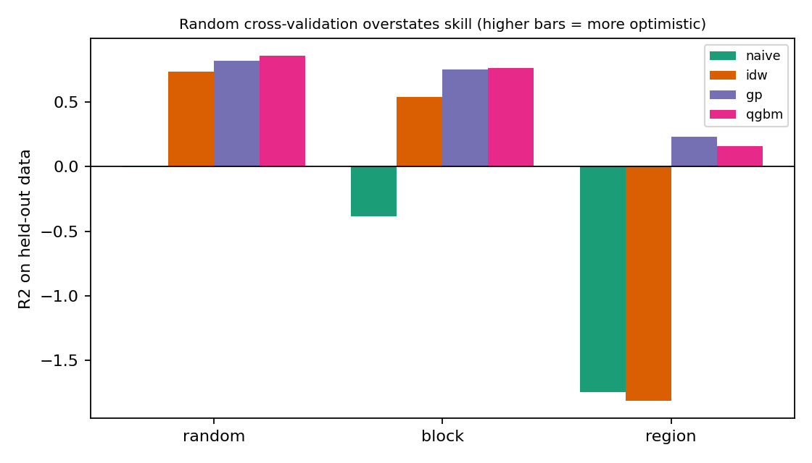
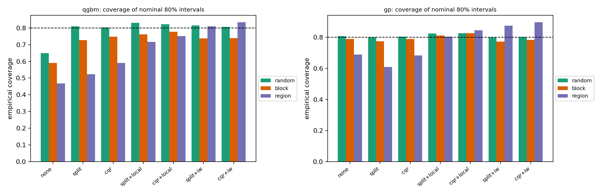
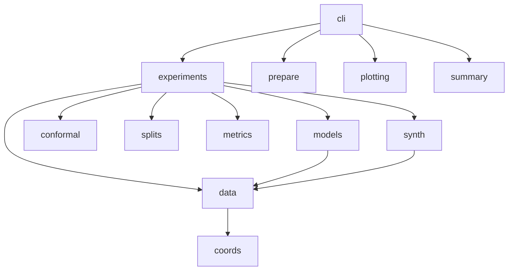

<div align="center">

# water-quality-uncertainty-benchmark

**Does cross-validation overstate how well we can predict groundwater contamination, and how trustworthy are the uncertainty intervals?**

A reproducible benchmark of spatial validation and conformal prediction for water-quality data, on real groundwater arsenic measurements
(20,575 wells in north Punjab, Pakistan, and 56,175 global 1 km pixels) and on a synthetic world with known truth


[](https://github.com/meelad-sultan/water-quality-uncertainty-benchmark/actions/workflows/ci.yml)

</div>

> **Scope and status**
> - **What this is:** a reproducible benchmark with tests and fixed seeds. It compares validation schemes and uncertainty-calibration methods; it is **not** a validated arsenic hazard map or a tool for decisions about real wells.
> - **Data:** two open datasets (cited in [data/README.md](data/README.md); raw files are not redistributed) plus a synthetic world. The Punjab arsenic values are **field test-kit categories**, not laboratory concentrations.
> - **Temporal part:** the real datasets are single snapshots, so spatiotemporal forecasting is demonstrated only on the **synthetic** world. A real time-series dataset is on the roadmap.
> - **Licences:** the dataset licences were not part of the supplied files; check each landing page before reusing or redistributing data.

---

## Table of contents
1. [Why this project](#1-why-this-project)
2. [Highlights](#2-highlights)
3. [Data](#3-data)
4. [Method](#4-method)
5. [Experiments](#5-experiments)
6. [Results](#6-results)
7. [Quickstart](#7-quickstart)
8. [Reproducing the study](#8-reproducing-the-study)
9. [Configuration and outputs](#9-configuration-and-outputs)
10. [Python API](#10-python-api)
11. [Using your own data](#11-using-your-own-data)
12. [Testing and CI](#12-testing-and-ci)
13. [Repository structure](#13-repository-structure)
14. [Troubleshooting](#14-troubleshooting)
15. [Limitations](#15-limitations)
16. [Roadmap](#16-roadmap)
17. [Citation, licence, references](#17-citation-licence-references)

---

## 1. Why this project

Maps and models of groundwater contamination are usually judged with random cross-validation. But monitoring wells are spatially clustered, and the real use of a
model is to predict **where nobody has measured yet**, often in a data-scarce region. Random cross-validation lets a model score well by predicting a well from its
neighbour in the same village, and the prediction intervals it reports can look reliable when they are not.

This repository asks, on real data:

1. **How much does random cross-validation overstate skill** compared with spatial-block, leave-one-region-out and transfer-to-a-new-region validation?
2. **Do uncertainty intervals and exceedance probabilities stay calibrated** when the model predicts into a new area?
3. **Do conformal prediction methods** (split, quantile-based, spatially weighted, importance-weighted) restore calibration, and what do they cost in interval width?

## 2. Highlights

- Two **real** open datasets and a synthetic world, run through one pipeline; the contaminant is a configuration entry, so the engine is not tied to arsenic.
- **Seven interval methods** (the model's own interval plus six conformal variants) and **four models** (naive, inverse-distance weighting, kriging, quantile gradient boosting).
- **Six validation schemes:** random, spatial block, leave-region-out, transfer to a held-out box, and (synthetic) forward-in-time and leave-site-out.
- Metrics: coverage, interval width, Winkler interval score, Brier score and expected calibration error for the probability of exceeding a threshold.
- A **data preparation step with checksums**, a loader for your own CSV, **19 automated tests**, CI, deterministic seeds.

## 3. Data

| Dataset | What it is | Rows used | Target and threshold |
|---|---|---|---|
| **North Punjab wells** (Mushtaq et al. 2022, IEDA) | Individual wells with coordinates, field arsenic reading and co-measured depth, EC, pH, nitrate, iron, sulphate, fluoride | 20,575 | Arsenic from a **field test kit** (categories 0, 10, 25, 50, 100, ...; 70 % read 0); exceedance above 10 ug/L (21 % of wells) |
| **Global arsenic** (Podgorski and Berg 2020, Eawag) | 1 km pixels with a compiled arsenic concentration and 51 predictors | 56,175 | Concentration (ug/L; about a quarter are non-detect placeholders); exceedance above 10 ug/L (19 % of pixels) |
| **Synthetic world** | Spatial field, covariates, heteroscedastic noise, one shifted region; optional season, trend and site effects | configurable | Known truth, so calibration can be measured exactly |

Full citations, caveats and processing steps are in [`data/README.md`](data/README.md); `docs/prepare_log.json` records row counts, the 11 malformed source lines that were skipped,
and the SHA-256 checksums of the raw files used for the committed results. An unused USGS "Activity" export is explained there too (it contains sampling events, not measurements).

## 4. Method



- **Models:** `naive` (global mean and spread); `idw` (inverse-distance-weighted neighbours); `gp` (universal kriging: ridge on covariates plus a Matern-3/2 Gaussian process on residuals, fitted on at most 400 points); `qgbm` (histogram gradient boosting with quantile loss for the interval and a classifier for the exceedance probability).
- **Interval methods:** `none` (the model's own interval); `split` (absolute-residual conformal); `cqr` (conformalised quantile regression); each of these with `+local` (calibration scores weighted by a spatial kernel around the test point) or `+iw` (scores weighted by an estimated density ratio between test and calibration inputs, as in conformal prediction under covariate shift).
- **Validation:** `random` K-fold; `block` (K-fold over spatial blocks); `region` (hold out one spatial cluster at a time); `box` (hold out all points in a latitude/longitude box and train on the rest); synthetic only: `time` (train on the past, predict the future, by lead time) and `site` (new sites).
- **Calibration data:** a quarter of each training set is set aside for conformal calibration, selected at random, so the calibration data follow the training distribution and not the held-out region (that is the realistic situation).
- **Metrics:** coverage of the nominal 80 % interval, mean width, interval score; Brier score and expected calibration error (10 bins) for the probability of exceeding the threshold.

Details and formulas: [`docs/method.md`](docs/method.md).

## 5. Experiments

| ID | Experiment | Data | Question |
|---|---|---|---|
| E1 | Validation optimism and interval coverage | Punjab, global, synthetic | How do accuracy, coverage and exceedance calibration change from random to spatial validation? |
| E2 | Transfer to a new region | Global (South Asia window), synthetic region shift | What happens when the model is applied to a region with a different distribution? |
| E3 | Ablation | Punjab, coordinates only | How much do co-measured water-chemistry covariates add? |
| E4 | Data scarcity | Punjab, synthetic | Does shrinking the training set change calibration under region shift? |
| E5 | Spatiotemporal forecasting | Synthetic only | Does coverage change with lead time and for new sites? |

## 6. Results

Numbers are weighted means over folds and repeats; repeats re-draw the fold assignment but use the same data, so the ranges they show understate sampling uncertainty.
All tables are generated by `python -m wqub summary`. Environment: Python 3.12.3, NumPy 2.4.4, SciPy 1.17.1, pandas 3.0.2, scikit-learn 1.8.0. The default runs take about 12 minutes in total on one core.

### 6.1 Real data: headline numbers

**Probability of exceeding 10 ug/L (lower Brier score and ECE are better)**

| Dataset | Validation | Gradient boosting Brier | Naive Brier | Gradient boosting ECE |
|---|---|---|---|---|
| Punjab wells | random | 0.087 | 0.169 | 0.020 |
| Punjab wells | spatial block | 0.136 | 0.171 | 0.087 |
| Punjab wells | leave-region-out | 0.132 | 0.190 | 0.069 |
| Global pixels | random | 0.112 | 0.155 | 0.018 |
| Global pixels | spatial block | 0.150 | 0.158 | 0.080 |
| Global pixels | leave-region-out | 0.161 | 0.164 | 0.123 |
| Global pixels | transfer to South Asia window (881 pixels) | 0.216 | 0.305 | 0.192 |

**Coverage of the nominal 80 % interval (gradient boosting)**

| Dataset | Validation | Model's own interval | Split conformal |
|---|---|---|---|
| Punjab wells | random / block / region | 0.91 / 0.84 / 0.83 | 0.83 / 0.83 / 0.81 |
| Global pixels | random / block / region / transfer | 0.87 / 0.86 / 0.80 / 0.31 | 0.80 / 0.69 / 0.63 / 0.39 |

| | |
|---|---|
|  |  |
| **Fig. 1.** Punjab: accuracy under each validation scheme | **Fig. 2.** Global: interval coverage by method and scheme |
|  |  |
| **Fig. 3.** Punjab: reliability of exceedance probabilities | **Fig. 4.** Global: reliability of exceedance probabilities |

<details>
<summary><b>Full tables: Punjab wells (coordinates + field water chemistry)</b></summary>

####### Real data: North Punjab (Pakistan) individual wells, field-kit arsenic

######## Accuracy under different validation schemes (weighted mean over folds and repeats)

| model | R2 random | R2 block | R2 region | RMSE (log1p scale) random | RMSE (log1p scale) block | RMSE (log1p scale) region |
|---|---|---|---|---|---|---|
| gp | -2.32 | -1.52 | -0.8 | 2.56 | 2.49 | 1.9 |
| idw | 0.52 | -0.17 | -0.22 | 1.26 | 1.92 | 1.66 |
| naive | -0.0 | -0.02 | -0.79 | 1.82 | 1.82 | 1.89 |
| qgbm | -0.39 | -0.39 | -0.47 | 2.14 | 2.13 | 1.97 |

######## Interval coverage by scheme (nominal 80%); width in parentheses

Model: **qgbm**

| method | random | block | region |
|---|---|---|---|
| none | 0.91 (2.65) | 0.84 (2.65) | 0.83 (2.37) |
| split | 0.83 (6.37) | 0.83 (6.23) | 0.81 (6.09) |
| cqr | 0.91 (2.65) | 0.84 (2.65) | 0.83 (2.37) |
| cqr+local | 0.91 (2.65) | 0.84 (2.68) | 0.85 (3.46) |
| cqr+iw | 0.91 (2.65) | 0.84 (2.65) | 0.83 (2.37) |

Model: **gp**

| method | random | block | region |
|---|---|---|---|
| none | 0.81 (3.56) | 0.82 (4.26) | 0.79 (4.48) |
| split | 0.80 (3.43) | 0.72 (3.36) | 0.68 (3.41) |
| cqr | 0.80 (3.42) | 0.82 (4.17) | 0.79 (4.38) |
| cqr+local | 0.81 (3.21) | 0.81 (3.97) | 0.76 (17.66) |
| cqr+iw | 0.80 (3.42) | 0.81 (4.11) | 0.70 (4.07) |

######## Leave-one-region-out coverage by held-out region (model qgbm)

| method | test region 0 | test region 1 | test region 2 | test region 3 | test region 4 |
|---|---|---|---|---|---|
| none | 0.82 | 0.78 | 0.67 | 0.82 | 0.92 |
| split | 0.74 | 0.8 | 0.52 | 0.87 | 1.0 |
| cqr | 0.82 | 0.78 | 0.67 | 0.82 | 0.92 |
| cqr+local | 0.82 | 0.89 | 0.68 | 0.93 | 0.92 |
| cqr+iw | 0.82 | 0.78 | 0.67 | 0.82 | 0.92 |

######## Exceedance probability: Brier score / expected calibration error

| model | random | block | region |
|---|---|---|---|
| gp | 0.107 / 0.034 | 0.143 / 0.086 | 0.181 / 0.158 |
| idw | 0.097 / 0.064 | 0.191 / 0.192 | 0.160 / 0.161 |
| naive | 0.169 / 0.029 | 0.171 / 0.058 | 0.190 / 0.163 |
| qgbm | 0.087 / 0.020 | 0.136 / 0.087 | 0.132 / 0.069 |

######## Data scarcity under leave-region-out: coverage (RMSE) by training fraction

Model: **gp**

| method | 0.1 | 0.25 | 0.5 | 1.0 |
|---|---|---|---|---|
| cqr | 0.78 (2.14) | 0.79 (1.86) | 0.78 (1.93) | 0.78 (1.87) |
| cqr+iw | 0.86 (2.14) | 0.75 (1.86) | 0.67 (1.93) | 0.69 (1.87) |
| none | 0.79 (2.14) | 0.80 (1.86) | 0.78 (1.93) | 0.80 (1.87) |
| split | 0.68 (2.14) | 0.72 (1.86) | 0.66 (1.93) | 0.70 (1.87) |

Model: **qgbm**

| method | 0.1 | 0.25 | 0.5 | 1.0 |
|---|---|---|---|---|
| cqr | 0.78 (1.97) | 0.79 (1.97) | 0.82 (1.97) | 0.82 (1.97) |
| cqr+iw | 0.88 (1.97) | 0.80 (1.97) | 0.82 (1.97) | 0.82 (1.97) |
| none | 0.78 (1.97) | 0.79 (1.97) | 0.82 (1.97) | 0.82 (1.97) |
| split | 0.81 (1.97) | 0.82 (1.97) | 0.81 (1.97) | 0.81 (1.97) |


</details>

<details>
<summary><b>Full tables: Punjab wells, coordinates only (ablation)</b></summary>

####### Real data: North Punjab wells, coordinates only (ablation)

######## Accuracy under different validation schemes (weighted mean over folds and repeats)

| model | R2 random | R2 block | R2 region | RMSE (log1p scale) random | RMSE (log1p scale) block | RMSE (log1p scale) region |
|---|---|---|---|---|---|---|
| gp | 0.4 | 0.08 | -0.66 | 1.4 | 1.72 | 1.84 |
| idw | 0.52 | -0.17 | -0.22 | 1.26 | 1.92 | 1.66 |
| naive | -0.0 | -0.02 | -0.79 | 1.82 | 1.82 | 1.89 |
| qgbm | -0.39 | -0.39 | -0.47 | 2.14 | 2.13 | 1.97 |

######## Interval coverage by scheme (nominal 80%); width in parentheses

Model: **qgbm**

| method | random | block | region |
|---|---|---|---|
| none | 0.91 (2.73) | 0.84 (2.77) | 0.81 (2.24) |
| split | 0.83 (6.37) | 0.83 (6.23) | 0.81 (6.09) |
| cqr | 0.91 (2.73) | 0.84 (2.77) | 0.81 (2.24) |
| cqr+local | 0.91 (2.73) | 0.84 (2.80) | 0.83 (3.38) |
| cqr+iw | 0.91 (2.73) | 0.84 (2.77) | 0.81 (2.24) |

Model: **gp**

| method | random | block | region |
|---|---|---|---|
| none | 0.81 (3.59) | 0.82 (4.45) | 0.81 (4.62) |
| split | 0.80 (3.49) | 0.75 (3.53) | 0.77 (3.41) |
| cqr | 0.80 (3.52) | 0.82 (4.45) | 0.81 (4.50) |
| cqr+local | 0.82 (3.09) | 0.79 (3.93) | 0.71 (5.09) |
| cqr+iw | 0.80 (3.53) | 0.81 (4.39) | 0.57 (4.26) |

######## Leave-one-region-out coverage by held-out region (model qgbm)

| method | test region 0 | test region 1 | test region 2 | test region 3 | test region 4 |
|---|---|---|---|---|---|
| none | 0.82 | 0.75 | 0.59 | 0.81 | 0.91 |
| split | 0.74 | 0.8 | 0.52 | 0.87 | 1.0 |
| cqr | 0.82 | 0.75 | 0.59 | 0.81 | 0.91 |
| cqr+local | 0.82 | 0.88 | 0.6 | 0.94 | 0.91 |
| cqr+iw | 0.82 | 0.75 | 0.59 | 0.81 | 0.91 |

######## Exceedance probability: Brier score / expected calibration error

| model | random | block | region |
|---|---|---|---|
| gp | 0.112 / 0.039 | 0.155 / 0.108 | 0.181 / 0.164 |
| idw | 0.097 / 0.064 | 0.191 / 0.192 | 0.160 / 0.161 |
| naive | 0.169 / 0.029 | 0.171 / 0.058 | 0.190 / 0.163 |
| qgbm | 0.091 / 0.021 | 0.153 / 0.114 | 0.153 / 0.101 |

######## Data scarcity under leave-region-out: coverage (RMSE) by training fraction

Model: **qgbm**

| method | 0.25 | 1.0 |
|---|---|---|
| cqr | 0.75 (1.98) | 0.79 (1.97) |
| cqr+iw | 0.78 (1.98) | 0.79 (1.97) |
| none | 0.75 (1.98) | 0.79 (1.97) |


</details>

<details>
<summary><b>Full tables: global arsenic dataset</b></summary>

####### Real data: Global groundwater arsenic (1 km pixels, 51 predictors)

######## Accuracy under different validation schemes (weighted mean over folds and repeats)

| model | R2 random | R2 block | R2 region | R2 box | RMSE (log1p scale) random | RMSE (log1p scale) block | RMSE (log1p scale) region | RMSE (log1p scale) box |
|---|---|---|---|---|---|---|---|---|
| naive | -0.0 | -0.02 | -0.22 | -0.26 | 1.42 | 1.41 | 1.4 | 2.4 |
| qgbm | 0.27 | 0.04 | -0.17 | 0.02 | 1.21 | 1.37 | 1.4 | 2.12 |

######## Interval coverage by scheme (nominal 80%); width in parentheses

Model: **qgbm**

| method | random | block | region | box |
|---|---|---|---|---|
| none | 0.87 (2.77) | 0.86 (3.03) | 0.80 (2.92) | 0.31 (3.10) |
| split | 0.80 (2.83) | 0.69 (2.74) | 0.63 (2.65) | 0.39 (2.73) |
| cqr | 0.87 (2.77) | 0.86 (3.03) | 0.80 (2.92) | 0.31 (3.10) |
| cqr+iw | 0.87 (2.77) | 0.86 (3.03) | 0.80 (2.92) | 0.31 (3.10) |

######## Leave-one-region-out coverage by held-out region (model qgbm)

| method | test region 0 | test region 1 | test region 2 | test region 3 | test region 4 | test region 5 | test region 6 | test region 7 |
|---|---|---|---|---|---|---|---|---|
| none | 0.65 | 0.94 | 0.97 | 0.75 | 0.87 | 0.26 | 0.92 | 0.65 |
| split | 0.33 | 0.94 | 0.96 | 0.79 | 0.86 | 0.25 | 0.34 | 0.6 |
| cqr | 0.65 | 0.94 | 0.97 | 0.75 | 0.87 | 0.26 | 0.92 | 0.65 |
| cqr+iw | 0.65 | 0.94 | 0.97 | 0.76 | 0.87 | 0.26 | 0.92 | 0.65 |

######## Exceedance probability: Brier score / expected calibration error

| model | random | block | region | box |
|---|---|---|---|---|
| naive | 0.155 / 0.028 | 0.158 / 0.066 | 0.164 / 0.138 | 0.305 / 0.240 |
| qgbm | 0.112 / 0.018 | 0.150 / 0.080 | 0.161 / 0.123 | 0.216 / 0.192 |

</details>


### 6.2 Synthetic world with known truth

A controlled shift (one region has different covariates, a higher mean and more noise) shows the mechanism cleanly. For gradient boosting, split-conformal coverage falls from
0.81 (random) to 0.73 (block) and 0.52 (leave-region-out) against a nominal 0.80. Importance weighting restores the **average** coverage under region shift
(0.83) but at roughly twice the interval width, and the shifted region itself stays under-covered because the weights correct covariate shift and not changes in noise or mean level.

| | |
|---|---|
|  |  |
| **Fig. 5.** Synthetic: accuracy by validation scheme | **Fig. 6.** Synthetic: coverage by method and scheme |

<details>
<summary><b>Full tables: synthetic benchmark (known truth)</b></summary>

####### Synthetic benchmark (known truth)

######## Accuracy under different validation schemes (weighted mean over folds and repeats)

| model | R2 random | R2 block | R2 region | RMSE (log1p scale) random | RMSE (log1p scale) block | RMSE (log1p scale) region |
|---|---|---|---|---|---|---|
| gp | 0.82 | 0.75 | 0.23 | 0.58 | 0.62 | 0.81 |
| idw | 0.74 | 0.54 | -1.81 | 0.7 | 0.83 | 1.55 |
| naive | -0.0 | -0.38 | -1.75 | 1.4 | 1.46 | 1.57 |
| qgbm | 0.86 | 0.77 | 0.16 | 0.52 | 0.6 | 0.89 |

######## Interval coverage by scheme (nominal 80%); width in parentheses

Model: **qgbm**

| method | random | block | region |
|---|---|---|---|
| none | 0.65 (0.96) | 0.59 (1.03) | 0.47 (1.44) |
| split | 0.81 (1.28) | 0.73 (1.26) | 0.52 (1.27) |
| cqr | 0.80 (1.34) | 0.75 (1.41) | 0.59 (1.82) |
| split+local | 0.83 (1.37) | 0.76 (1.43) | 0.72 (2.23) |
| cqr+local | 0.82 (1.43) | 0.78 (1.55) | 0.75 (2.63) |
| split+iw | 0.82 (1.29) | 0.74 (1.31) | 0.81 (3.00) |
| cqr+iw | 0.81 (1.35) | 0.74 (1.39) | 0.83 (3.35) |

Model: **gp**

| method | random | block | region |
|---|---|---|---|
| none | 0.81 (1.47) | 0.79 (1.52) | 0.69 (1.68) |
| split | 0.80 (1.46) | 0.77 (1.47) | 0.61 (1.44) |
| cqr | 0.80 (1.48) | 0.79 (1.54) | 0.68 (1.67) |
| split+local | 0.82 (1.58) | 0.81 (1.64) | 0.80 (2.38) |
| cqr+local | 0.83 (1.59) | 0.83 (1.71) | 0.84 (2.62) |
| split+iw | 0.80 (1.46) | 0.77 (1.48) | 0.87 (3.05) |
| cqr+iw | 0.80 (1.47) | 0.78 (1.52) | 0.90 (3.27) |

######## Leave-one-region-out coverage by held-out region (model qgbm)

| method | test region 0 | test region 1 | test region 2 | test region 3 |
|---|---|---|---|---|
| none | 0.47 | 0.65 | 0.4 | 0.37 |
| split | 0.52 | 0.61 | 0.59 | 0.35 |
| cqr | 0.61 | 0.76 | 0.55 | 0.45 |
| split+local | 0.75 | 0.87 | 0.77 | 0.45 |
| cqr+local | 0.78 | 0.91 | 0.76 | 0.55 |
| split+iw | 0.86 | 0.95 | 0.83 | 0.58 |
| cqr+iw | 0.82 | 0.94 | 0.89 | 0.67 |

######## Exceedance probability: Brier score / expected calibration error

| model | random | block | region |
|---|---|---|---|
| gp | 0.056 / 0.040 | 0.059 / 0.046 | 0.093 / 0.104 |
| idw | 0.069 / 0.047 | 0.087 / 0.075 | 0.249 / 0.270 |
| naive | 0.160 / 0.020 | 0.169 / 0.116 | 0.209 / 0.264 |
| qgbm | 0.061 / 0.055 | 0.071 / 0.063 | 0.165 / 0.173 |

######## Data scarcity under leave-region-out: coverage (RMSE) by training fraction

Model: **gp**

| method | 0.1 | 0.25 | 0.5 | 1.0 |
|---|---|---|---|---|
| cqr | 0.81 (0.73) | 0.80 (0.67) | 0.80 (0.66) | 0.80 (0.67) |
| cqr+iw | 0.93 (0.73) | 0.93 (0.67) | 0.90 (0.66) | 0.91 (0.67) |
| cqr+local | 0.93 (0.73) | 0.91 (0.67) | 0.90 (0.66) | 0.88 (0.67) |
| none | 0.71 (0.73) | 0.78 (0.67) | 0.81 (0.66) | 0.80 (0.67) |
| split | 0.79 (0.73) | 0.75 (0.67) | 0.73 (0.66) | 0.72 (0.67) |

Model: **qgbm**

| method | 0.1 | 0.25 | 0.5 | 1.0 |
|---|---|---|---|---|
| cqr | 0.70 (1.23) | 0.69 (0.98) | 0.76 (0.89) | 0.73 (0.88) |
| cqr+iw | 0.85 (1.23) | 0.85 (0.98) | 0.87 (0.89) | 0.85 (0.88) |
| cqr+local | 0.89 (1.23) | 0.84 (0.98) | 0.85 (0.89) | 0.82 (0.88) |
| none | 0.54 (1.23) | 0.53 (0.98) | 0.63 (0.89) | 0.63 (0.88) |
| split | 0.71 (1.23) | 0.64 (0.98) | 0.63 (0.89) | 0.61 (0.88) |


######## Spatiotemporal forecasting (synthetic): coverage by scheme and lead time, model qgbm

| method | site / all | time / lead 1 | time / lead 2 | time / lead 3 |
|---|---|---|---|---|
| cqr | 0.73 | 0.71 | 0.74 | 0.69 |
| cqr+iw | 0.73 | 0.87 | 0.99 | 0.99 |
| none | 0.65 | 0.61 | 0.63 | 0.61 |
| split | 0.71 | 0.73 | 0.79 | 0.71 |

</details>


### 6.3 What the results support

1. **Random cross-validation overstates skill on real data.** For the probability of exceeding 10 ug/L, gradient boosting has a Brier score of 0.087 (random) but 0.136 (block) and 0.132 (region) on the Punjab wells, against a naive baseline of about 0.171 to 0.190; its calibration error rises from 0.020 to 0.087. On the global pixels the Brier score rises from 0.112 to 0.161, almost the naive value (0.164).
2. **Neighbour-based prediction is most exposed.** Inverse-distance weighting reaches R2 = 0.52 under random validation on the Punjab wells and R2 = -0.17 under spatial-block validation, which is the signature of predicting a well from a neighbour in the same village.
3. **Transfer to a new region is where it hurts.** Training on the rest of the world and predicting the South Asia window gives 80 % intervals that cover only 0.31 (own interval) or 0.39 (split conformal) of the observations. The exceedance probabilities beat the naive baseline (Brier 0.216 against 0.305) but are poorly calibrated (ECE 0.192). The window's observed exceedance rate is 0.45 against 0.19 globally, and the model predicts 0.31 on average there, so it under-predicts the risk.
4. **Split conformal intervals lose coverage under spatial validation.** Global: 0.80, 0.69, 0.63, 0.39 for random, block, region and transfer; Punjab kriging: 0.80, 0.72, 0.68. This matches the synthetic world.
5. **Field water chemistry helps, modestly.** Using coordinates only, the Punjab Brier score is 0.153 (block) and 0.153 (region), against 0.136 and 0.132 with the co-measured covariates.

### 6.4 What the results do **not** support

- **No conformal variant fixed the problem on the real data.** For the zero-inflated targets, the CQR calibration step returned exactly zero: 21 % of the global calibration scores (and 69 % of the Punjab scores) sit exactly on the lower bound, so the conformal quantile is 0 and `cqr`, and `cqr+iw`, reproduce the model's own interval. Spatial-local weighting widened some intervals enormously when the held-out region was far from the calibration data (Punjab kriging, region scheme: mean width above 17 log-units). This is a limitation of how these scores behave on non-negative, zero-heavy targets, not evidence that conformal methods cannot help.
- **Punjab regression metrics are not informative for gradient boosting.** With 70 % of readings at 0, its median prediction collapses to 0 for most wells (RMSE identical across training fractions), so the accuracy tables for that model on that dataset should be ignored; the exceedance probabilities and kriging/IDW comparisons are the meaningful outputs there. The kriging baseline is also handicapped by its 400-point training cap and by a linear mean on raw covariates (it scores worse with covariates than without).
- **Held-out regions are arbitrary.** They are k-means clusters of the coordinates (5 for Punjab, 8 globally); different cluster definitions would give different numbers.
- **The two datasets cannot be compared directly.** They have different targets (kit category versus averaged concentration), units of observation and threshold behaviour.
- **No temporal conclusion on real data.** The spatiotemporal experiment is synthetic; at later lead times importance-weighted intervals over-cover (about 0.99) and are very wide.
- **No decision-ready arsenic map.** Nothing here estimates the risk at a specific well.

## 7. Quickstart

Requirements: Python 3.10 or newer; no commercial software. The quick run uses only the built-in synthetic world.

```bash
git clone https://github.com/meelad-sultan/water-quality-uncertainty-benchmark.git
cd water-quality-uncertainty-benchmark
python -m venv .venv
source .venv/bin/activate            # Windows (PowerShell): .venv\Scripts\Activate.ps1
python -m pip install --upgrade pip
python -m pip install -e ".[dev]"

python -m pytest                                                        # about 15 s
python -m wqub run --config configs/quick.yaml --out results/quick     # a few seconds
python -m wqub figures --results results/quick --out results/quick/figures
python -m wqub summary --results results/quick
```

## 8. Reproducing the study

**Synthetic benchmark** (about 2 minutes):
```bash
python -m wqub run --config configs/default.yaml --out results/metrics
```

**Real data** (about 10 minutes in total). Download the files named in [`data/README.md`](data/README.md) into `data/raw/`, then:
```bash
python -m wqub prepare                                    # writes data/processed/*.csv and prepare_log.json
python -m wqub real --config configs/real_punjab.yaml        --out results/real/punjab
python -m wqub real --config configs/real_punjab_coords.yaml --out results/real/punjab_coords
python -m wqub real --config configs/real_global.yaml        --out results/real/global
python -m wqub figures --results results/real/punjab --out results/figures/real_punjab     # likewise for the others
python -m wqub summary --results results/real/punjab > results/real/punjab/summary.md
```
Randomness is seeded from `seed` and the experiment keys, so results are repeatable on the same library versions; compare your `prepare_log.json` checksums with `docs/prepare_log.json` first.

## 9. Configuration and outputs

All settings live in YAML (`configs/default.yaml`; the other files inherit from it with `extends:`).

| Section | Meaning |
|---|---|
| `alpha` | miscoverage level (0.2 gives 80 % intervals) |
| `synthetic` | size, spatial range, noise and the region shift of the synthetic world; `temporal` for the forecasting variant |
| `cv` | number of folds, block size (km), calibration fraction, spatial bandwidth, importance-weight clipping |
| `models`, `methods` | which models and interval methods to run |
| `gp`, `qgbm` | kriging training cap; boosting settings |
| `experiments` | repeats and schemes for the validation study, scarcity and forecasting experiments |
| `real` | CSV path, column mapping, exceedance limit, handling of non-positive values, held-out boxes |

| Output (`results/...`) | Content |
|---|---|
| `cv_study.csv`, `real_cv_study.csv` | one row per fold, model, interval method and group, with accuracy, coverage, width, interval score, Brier and ECE |
| `reliability.csv`, `real_reliability.csv` | binned predicted probability against observed frequency |
| `scarcity.csv`, `spatiotemporal.csv` | scarcity and forecasting experiments |
| `real_data_summary.json`, `run_metadata_*.json`, `summary.md` | dataset summary; configuration, versions and timings; markdown tables |

## 10. Python API

```python
from wqub.config import load_config
from wqub.data import load_csv
from wqub.experiments import evaluate_fold, make_folds, rng_for

cfg = load_config("configs/real_punjab.yaml")          # needs data/processed/punjab_wells.csv (see section 8)
D = load_csv(cfg)
rng = rng_for(cfg["seed"], 0)
fold = make_folds(D, "block", cfg, rng)[0]              # first spatial-block fold
rows, reliability = evaluate_fold(D, fold, cfg, ["qgbm"], ["none", "cqr"], rng, seed=0)
print(rows[0]["coverage"], rows[0]["brier"])
```

## 11. Using your own data

Copy `configs/real_template.yaml`, set the CSV path and column names, then check the mapping with `python -m wqub check --config <your file>` and run
`python -m wqub real --config <your file> --out results/real/mine`. Add `region`, `time` or `site` columns to unlock leave-region-out, forward-in-time or leave-site-out validation, and `boxes` plus `coords: global` for transfer tests on continental data.

## 12. Testing and CI

```bash
python -m pytest        # 19 tests
python -m ruff check .
```

The tests cover: the synthetic generator (determinism, shift, shapes); every validation scheme (folds partition the data, blocks and regions never leak into training); conformal calibration (exact quantile index, nominal coverage on exchangeable data, importance weighting helps under a controlled covariate shift, the chunked spatial weighting matches a plain reference implementation); metrics; the four models; the CSV loader and the preparation parsers (built from synthetic files that mimic the raw formats); and an end-to-end run with figures and summaries.
GitHub Actions runs lint and tests on Python 3.10 and 3.12 for every push.

## 13. Repository structure

```text
water-quality-uncertainty-benchmark/
├── README.md  LICENSE  CITATION.cff  pyproject.toml
├── configs/   default.yaml  quick.yaml  real_punjab.yaml  real_punjab_coords.yaml  real_global.yaml  real_template.yaml
├── data/      README.md  (raw/ and processed/ are git-ignored)
├── docs/      technical_report.md  method.md  architecture.md  prepare_log.json  NEXT_STEPS.md
├── src/wqub/  coords.py data.py synth.py splits.py models.py conformal.py metrics.py experiments.py prepare.py summary.py plotting.py config.py cli.py
├── tests/     conftest.py  test_synth_splits.py  test_conformal_metrics.py  test_models_data.py  test_real_data.py
├── results/   metrics/ (synthetic)   real/{punjab,punjab_coords,global}/   figures/
└── .github/workflows/ci.yml
```

### Module dependencies



## 14. Troubleshooting

| Problem | Likely fix |
|---|---|
| `ModuleNotFoundError: openpyxl` | `python -m pip install -e ".[dev]"` (it is a declared dependency) |
| `prepare` says no recognised raw files | keep the original file names in `data/raw/` (`*Well_individual*.xlsx` and `arsenic_concentrations_predictor_data.csv`) |
| The workbook layout error from `prepare` | the Excel layout changed; check the header rows against `src/wqub/prepare.py` |
| Real runs are slow | lower `experiments.cv_study.reps` or remove `cqr+local` from `methods` |
| Different numbers from the README | different library versions; compare `run_metadata_*.json`; the interval metrics are deterministic only for fixed versions |

## 15. Limitations

1. **Targets.** Punjab arsenic is a field test-kit category and is zero-inflated; the global values are averaged over 1 km pixels and include non-detect placeholders. Regression-style metrics are weak there; exceedance probabilities are the more meaningful output.
2. **Single snapshots.** Neither real dataset has usable time series, so temporal results are synthetic.
3. **Region definitions** are k-means clusters, and the transfer box is one latitude/longitude window; results depend on both choices.
4. **Baselines are simple.** Kriging uses at most 400 training points and a linear mean on raw covariates; no deep or graph models are included; hyper-parameters were not tuned.
5. **Conformal methods on zero-inflated targets** have degenerate correction steps (section 6.4); classification-style conformal sets were not implemented.
6. **Calibration data come from the training distribution** by design; using held-out-region data for calibration would be a different (and stronger) setting.
7. **Repeats re-draw folds only**, so the reported ranges do not include uncertainty from the finite sample of wells.
8. **No confounding by sampling design is modelled:** wells are not a random sample of aquifers.
9. **Not a decision tool.** Nothing here should guide drinking-water decisions.

## 16. Roadmap

- A real time-series case study from the USGS Water Quality Portal (download the sample-results and site files; see `data/README.md`).
- Ordinal or hurdle models for field-kit data; conformal prediction sets for the exceedance classification.
- Better kriging baselines (more points, sparse approximations, robust covariate handling) and neural or graph models for comparison.
- Held-out-region calibration, and external covariate rasters (climate, soil, geology) for the Punjab wells.
- Other contaminants (fluoride, nitrate, a metal) through the same configuration.

## 17. Citation, licence, references

**Cite as** (see `CITATION.cff`): Sultan, M. M. (2026). *water-quality-uncertainty-benchmark: calibrated uncertainty for spatial water-quality prediction under distribution shift* (v0.1.0). GitHub repository.

**Licence:** MIT for the code (see `LICENSE`). Data are **not** covered by this licence; follow the terms of the original sources.

**Author:** Muhammad Meelad Sultan · GitHub: [@meelad-sultan](https://github.com/meelad-sultan)

**Development note.** This project was developed with assistance from Claude (Anthropic) for drafting code and documentation. The author is responsible for the repository; the code, tests and results are to be reviewed and reproduced by the author before release.

**Data sources (please cite when using the data)**
- Mushtaq, N., Farooqi, A., Khattak, J., Hussain, I., Mailloux, B., Bostick, B., Nghiem, A., van Geen, A., 2022. *Well water and drill cuttings from north Punjab, Pakistan v.2*, Version 1.0. Interdisciplinary Earth Data Alliance (IEDA). https://doi.org/10.26022/IEDA/112724
- Podgorski, J., and Berg, M. (2020). Global threat of arsenic in groundwater. *Science* 368(6493), 845-850. doi:10.1126/science.aba1510 (data package and code: Eawag open data; contact joel.podgorski@eawag.ch, michael.berg@eawag.ch)

**Methods literature** (bibliographic details written from memory; verify before citing)
- Vovk, V., Gammerman, A. and Shafer, G. (2005). *Algorithmic Learning in a Random World*. Springer.
- Lei, J., G'Sell, M., Rinaldo, A., Tibshirani, R. J. and Wasserman, L. (2018). Distribution-free predictive inference for regression. *Journal of the American Statistical Association* 113.
- Romano, Y., Patterson, E. and Candes, E. (2019). Conformalized quantile regression. *Advances in Neural Information Processing Systems* 32.
- Tibshirani, R. J., Barber, R. F., Candes, E. and Ramdas, A. (2019). Conformal prediction under covariate shift. *Advances in Neural Information Processing Systems* 32.
- Roberts, D. R. et al. (2017). Cross-validation strategies for data with temporal, spatial, hierarchical, or phylogenetic structure. *Ecography* 40.
- Ploton, P. et al. (2020). Spatial validation reveals poor predictive performance of large-scale ecological mapping models. *Nature Communications* 11.
- Meyer, H. and Pebesma, E. (2021). Predicting into unknown space? Estimating the area of applicability of spatial prediction models. *Methods in Ecology and Evolution* 12.
- Gneiting, T. and Raftery, A. E. (2007). Strictly proper scoring rules, prediction, and estimation. *Journal of the American Statistical Association* 102.
- Guo, C., Pleiss, G., Sun, Y. and Weinberger, K. Q. (2017). On calibration of modern neural networks. *Proceedings of the 34th International Conference on Machine Learning*.
